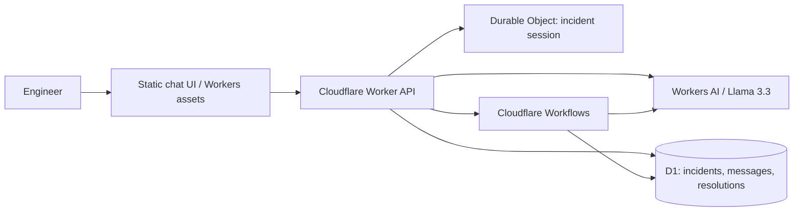

# Cloudflare AI SRE Incident Copilot

An AI-powered incident investigation workspace built with Cloudflare Workers AI, Workers, Workflows, Durable Objects, D1, and static assets served by Workers. It is designed as a practical reliability engineering demo: evidence first, safe diagnostics first, and a human approves any production change.

## What it does
- Chat with an SRE-focused AI assistant about incidents, logs, metrics, and Kubernetes events.
- Keep incident conversations and history in Cloudflare D1.
- Use a Durable Object for bounded per-incident session state.
- Start a retryable, multi-step Cloudflare Workflow for longer investigations.
- Save investigation findings and incident severity/status.
- Includes sample scenarios for CrashLoopBackOff/OOMKilled, latency and 5xx spikes, pending pods/Karpenter, and deployment regressions.
- Includes tests and GitHub Actions CI.

> **Important:** This project does not connect to a real cluster, cloud account, or observability platform by default. The assistant analyzes information supplied by the user and must not claim that it executed commands or inspected live telemetry. Production integrations should be added explicitly, with scoped credentials and approval gates.

## Architecture


## Components
- **Workers AI:** Uses `@cf/meta/llama-3.3-70b-instruct-fp8-fast` by default. Model availability and account access may vary; override `AI_MODEL` if needed.
- **Workers:** Validates input and exposes `/api/*` endpoints.
- **Workflows:** Multi-step investigation: prepare input, analyze evidence, persist findings.
- **Durable Objects:** Bounded recent-message buffer per incident.
- **D1:** Persists incidents, chat messages, and resolutions.
- **Static assets:** Responsive single-page frontend served by the Worker.

## Requirements
- Node.js 20+
- Cloudflare account with Workers AI enabled
- Wrangler CLI (installed as a dev dependency)
- Permission to create a D1 database and deploy Workers/Workflows

## Local setup
1. Install dependencies: `npm install`
2. Authenticate: `npx wrangler login`
3. Create a D1 database: `npx wrangler d1 create sre-copilot-db`
4. Replace `REPLACE_WITH_D1_DATABASE_ID` in `wrangler.toml` with the returned ID.
5. Apply schema: `npx wrangler d1 migrations apply sre-copilot-db --local`
6. Start: `npm run dev`
7. Open the local URL Wrangler prints and try a sample scenario.

## Deploy
After configuring D1 and confirming Workers AI access:
```bash
npx wrangler d1 migrations apply sre-copilot-db --remote
npm run deploy
```
Follow any prompts for Workflow configuration. If required by your account/Wrangler version, create a Workflow named `sre-incident-investigation` using the exported `IncidentInvestigationWorkflow` class.

## API
| Method | Path | Purpose |
|---|---|---|
| GET | `/api/health` | Health check |
| POST | `/api/chat` | Chat; creates an incident if no `incidentId` is supplied |
| GET | `/api/incidents` | List recent incidents |
| POST | `/api/incidents` | Create an incident |
| GET | `/api/incidents/:id` | Read incident, messages, and resolutions |
| DELETE | `/api/incidents/:id` | Delete incident and related D1 records |
| POST | `/api/investigate` | Start multi-step Workflow investigation |
| POST | `/api/resolutions` | Save a resolution |

Example:
```bash
curl -X POST http://localhost:8787/api/chat -H 'content-type: application/json' -d '{"message":"Pods are restarting after a deployment. What should I check first?"}'
```

## Security checklist
Before exposing this demo publicly:
- Add authentication and authorization; scope incidents to the authenticated user/tenant.
- Replace permissive CORS with an explicit origin allowlist (or remove CORS if same-origin only).
- Add rate limiting, abuse prevention, and request-size limits.
- Review data retention and privacy for pasted incident logs; redact secrets and PII.
- Add request IDs, model latency/token metrics, and alerts.
- Require human approval and audit logs before any remediation integration can change infrastructure.
- Validate model availability, account quotas, and Workflow configuration.
- Add pagination and tenant isolation for multi-user workloads.

## Commands
```bash
npm test
npm run typecheck
npm run dev
npm run deploy
```

## Project layout
```text
public/                 Responsive frontend
src/index.js            Worker API and routing
src/session.js          Durable Object session state
src/workflow.js         Multi-step investigation Workflow
src/utils.js            Shared validation and prompt helpers
migrations/             D1 schema
tests/                  Unit tests
.github/workflows/      CI
wrangler.toml           Cloudflare bindings and deployment config
```

## Trade-offs
D1 is the durable source of truth; Durable Objects keep only a bounded recent-message buffer. Interactive chat responds synchronously; longer investigations use Workflows. The model sees only user-supplied context and persisted conversation history. It recommends actions but never executes infrastructure changes.

## License
MIT. See [LICENSE](LICENSE).
