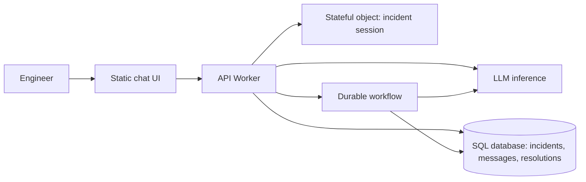

# SRE Incident Copilot

An AI-powered incident investigation workspace built with an edge Worker runtime, an LLM inference binding, durable workflows, stateful objects, a SQL database, and static web assets. It is designed as a practical reliability engineering demo: evidence first, safe diagnostics first, and a human approves any production change.

## What it does
- Chat with an SRE-focused AI assistant about incidents, logs, metrics, and Kubernetes events.
- Keep incident conversations and history in a SQL database.
- Use a stateful object for bounded per-incident session state.
- Start a retryable, multi-step workflow for longer investigations.
- Save investigation findings and incident severity/status.
- Includes sample scenarios for CrashLoopBackOff/OOMKilled, latency and 5xx spikes, pending pods/capacity provisioning, and deployment regressions.
- Includes tests and GitHub Actions CI.

> **Important:** This project does not connect to a real cluster, cloud account, or observability platform by default. The assistant analyzes information supplied by the user and must not claim that it executed commands or inspected live telemetry. Production integrations should be added explicitly, with scoped credentials and approval gates.

## Architecture


## Components
- **LLM inference:** Uses the configured Llama 3.3 70B Instruct model identifier by default. Model availability and account access may vary; override `AI_MODEL` if needed.
- **API Worker:** Validates input and exposes `/api/*` endpoints.
- **Durable workflow:** Multi-step investigation: prepare input, analyze evidence, persist findings.
- **Stateful object:** Keeps a bounded recent-message buffer per incident.
- **SQL database:** Persists incidents, chat messages, and resolutions.
- **Static assets:** Responsive single-page frontend served by the Worker.

## Requirements
- Node.js 20+
- An account and project with access to the configured inference model
- Wrangler CLI (installed as a dev dependency)
- Permission to create the database and deploy the Worker/workflow resources

## Local setup
1. Install dependencies: `npm install`
2. Authenticate with the deployment platform: `npx wrangler login`
3. Create a database: `npx wrangler d1 create sre-copilot-db`
4. Replace `REPLACE_WITH_D1_DATABASE_ID` in `wrangler.toml` with the returned ID.
5. Apply schema: `npx wrangler d1 migrations apply sre-copilot-db --local`
6. Start: `npm run dev`
7. Open the local URL printed by Wrangler and try a sample scenario.

## Deploy
After configuring the database and confirming model access:
```bash
npx wrangler d1 migrations apply sre-copilot-db --remote
npm run deploy
```
Follow any prompts for workflow configuration. If required by your account or CLI version, create a workflow named `sre-incident-investigation` using the exported `IncidentInvestigationWorkflow` class.

## API
| Method | Path | Purpose |
|---|---|---|
| GET | `/api/health` | Health check |
| POST | `/api/chat` | Chat; creates an incident if no `incidentId` is supplied |
| GET | `/api/incidents` | List recent incidents |
| POST | `/api/incidents` | Create an incident |
| GET | `/api/incidents/:id` | Read incident, messages, and resolutions |
| DELETE | `/api/incidents/:id` | Delete incident and related records |
| POST | `/api/investigate` | Start multi-step workflow investigation |
| POST | `/api/resolutions` | Save a resolution |

Example:
```bash
curl -X POST http://localhost:8787/api/chat -H 'content-type: application/json' -d '{"message":"Pods are restarting after a deployment. What should I check first?"}'
```

## Security checklist
Before exposing this demo publicly:
- Add authentication and authorization; scope incidents to the authenticated user/tenant.
- Replace permissive CORS with an explicit origin allowlist (or remove CORS if same-origin only).
- Add rate limiting, abuse prevention, and request-size limits.
- Review data retention and privacy for pasted incident logs; redact secrets and personal information.
- Add request IDs, model latency/token metrics, and alerts.
- Require human approval and audit logs before any remediation integration can change infrastructure.
- Validate model availability, account quotas, and workflow configuration.
- Add pagination and tenant isolation for multi-user workloads.

## Commands
```bash
npm test
npm run typecheck
npm run dev
npm run deploy
```

## Project layout
```text
public/                 Responsive frontend
src/index.js            API Worker and routing
src/session.js          Stateful incident session
src/workflow.js         Multi-step investigation workflow
src/utils.js            Shared validation and prompt helpers
migrations/             SQL schema
tests/                  Unit tests
.github/workflows/      CI
wrangler.toml           Runtime bindings and deployment config
```

## Trade-offs
The SQL database is the durable source of truth; stateful objects keep only a bounded recent-message buffer. Interactive chat responds synchronously; longer investigations use durable workflows. The model sees only user-supplied context and persisted conversation history. It recommends actions but never executes infrastructure changes.

## License
MIT. See [LICENSE](LICENSE).
